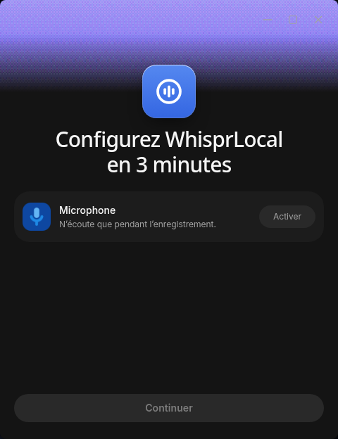

# WhisprLocal

**Votre voix, votre ordinateur, vos modèles.** Une édition Linux indépendante dérivée d’[OpenWhispr](https://github.com/OpenWhispr/openwhispr), consacrée aux modèles locaux et aux serveurs auto-hébergés explicitement configurés.

[English](README.md) · [Téléchargements](https://github.com/valoche-68/whisprlocal/releases) · [Contribuer](.github/CONTRIBUTING.md)

> Projet indépendant, **sans affiliation avec OpenWhispr, Gizmo Labs ou OpenAI**, sans approbation ni exploitation par ces organisations. Whisper est un modèle initialement publié par OpenAI ; son utilisation ne crée aucune affiliation.



Version du projet : **0.1.0**. Base officielle : **OpenWhispr 1.11.0**, suivie séparément dans [`upstream.json`](upstream.json).

## La même interface, centrée sur le local

La disposition, les composants, les thèmes et les écrans de premier démarrage officiels sont conservés. Les étapes liées aux comptes et aux services supprimés sont sautées. Dictée, raccourcis, presse-papier, collage automatique, notes, réunions, fichiers audio, dictionnaire, extraits, assistants et statistiques locales restent disponibles avec les modèles locaux ou les serveurs auto-hébergés pris en charge.

Whisper se décharge **cinq secondes après la fin complète de la transcription** par défaut. Un interrupteur et les délais 5 / 10 / 30 / 60 / 300 secondes sont persistants et appliqués immédiatement. La dictée suivante recharge le modèle. Les packs CUDA officiels complets fournissent leurs bibliothèques CUDA 12 ; aucun environnement Python personnel n’est nécessaire.

## Ce qui disparaît

Aucun compte, connexion, abonnement, facturation, forfait, espace d’équipe ou synchronisation officielle. Aucun fournisseur d’IA cloud ni configuration de ses clés. Le MCP distant et la CLI cloud sont remplacés par des outils locaux. Les calendriers et connecteurs nécessitant un compte tiers sont retirés, sans prétendre les convertir en services locaux.

La télémétrie et les envois de diagnostics sont supprimés, sans option de réactivation. Les statistiques conservées sur cet ordinateur restent disponibles. Le traitement d’images par l’assistant exige un modèle adapté ; la transcription de réunions en temps réel sur serveur auto-hébergé n’est pas fournie par la base 1.11.0.

## Plateforme prise en charge

**Linux x86_64 uniquement.** Windows, macOS et Android ne sont ni pris en charge ni publiés. L’historique conserve le code multiplateforme amont. L’accélération GPU est facultative ; le CPU reste disponible.

## Installation

Téléchargez le `.deb`, l’AppImage ou le `.tar.gz`, ainsi que `SHA256SUMS`, dans les [versions de ce dépôt](https://github.com/valoche-68/whisprlocal/releases), puis vérifiez les fichiers :

```sh
sha256sum --check SHA256SUMS --ignore-missing
```

Installez le paquet Debian avec votre gestionnaire de paquets. Pour l’AppImage, rendez le fichier exécutable et lancez-le ; un paquet de compatibilité FUSE peut être nécessaire.

Pour une installation décompactée dans votre espace utilisateur, extrayez l’archive puis lancez **`resources/install.sh` depuis le dossier extrait de l’application**. L’installation utilise `~/.local/opt/WhisprLocal`, des dossiers versionnés, une entrée de menu et la commande `~/.local/bin/whisprlocal`. Ajoutez `~/.local/bin` à votre `PATH` si nécessaire.

Les modèles compatibles déjà présents dans le cache OpenWhispr sont réutilisés. L’import d’un profil ne déclenche pas leur téléchargement complet. Une fois les modèles installés, la transcription locale fonctionne hors connexion.

## Conserver les paramètres existants

Fermez les deux applications, puis lancez cette commande depuis la nouvelle application extraite :

```sh
./whisprlocal --cli profile migrate "$HOME/.config/open-whispr"
```

Une sauvegarde privée complète précède l’import des préférences, raccourcis, base locale et fichiers audio conservés vers **`~/.config/whisprlocal`**. Un profil de destination existant n’est jamais écrasé. Les cookies, sessions de connexion, identifiants cloud, identités de synchronisation et journaux privés sont exclus.

Les packs GPU compatibles sont préservés ; les packs anciens doivent être remplacés par les packs officiels complets. Les identifiants d’un serveur auto-hébergé peuvent devoir être saisis à nouveau si l’ancienne application les chiffrait dans un stockage lié à son compte. L’installation et le profil d’origine restent récupérables. Le fichier privé `migration-report.json` indique le chemin de sauvegarde.

**Ne publiez jamais de profil, sauvegarde, jeton, journal privé ou modèle sur ce dépôt.**

## CLI, API et MCP locaux

L’application doit être ouverte. Aucun compte, clé cloud ou paquet CLI npm séparé n’est nécessaire.

```sh
whisprlocal --cli notes list
whisprlocal --cli notes search --q "réunion"
whisprlocal --cli dictionary list
whisprlocal --cli history list
whisprlocal --cli transcribe file /chemin/absolu/audio.wav --language fr
whisprlocal --cli --help
```

L’API expose les notes, dossiers, dictionnaire, extraits, historique et transcription de fichiers avec les modèles installés. Le pont écoute uniquement sur **127.0.0.1**. Son jeton technique est stocké dans `~/.whisprlocal/cli-bridge.json`, en mode **0600**, et lu automatiquement par les clients intégrés. Ne partagez pas ce fichier.

L’écran Intégrations fournit la configuration MCP stdio à copier, avec le chemin absolu de votre exécutable. Les modifications d’un client MCP affectent les mêmes données locales : configurez les confirmations dans ce client. Si WhisprLocal est fermé, la CLI et le MCP affichent une erreur explicite.

## Confidentialité

Aucun client de compte, synchroniseur officiel, émetteur de télémétrie ou envoi de diagnostics. Les statistiques restent dans SQLite. Les sessions Electron et les requêtes HTTP/fetch de Node bloquent les domaines web officiels et les destinations non configurées.

Les connexions nécessaires sont conservées : téléchargements de modèles et moteurs depuis leurs sources GitHub et Hugging Face, mises à jour de ce dépôt, serveurs que vous configurez explicitement. Un serveur auto-hébergé reçoit les données que vous lui envoyez. Vous pouvez couper le réseau après installation des modèles locaux. Voir [la documentation détaillée](docs/PRIVACY.md).

## Mises à jour et retour arrière

Les mises à jour proviennent exclusivement de **`valoche-68/whisprlocal`**. Aucune version officielle non adaptée ne remplace automatiquement WhisprLocal.

L’AppImage utilise la mise à jour intégrée. L’installation décompactée télécharge l’archive, vérifie son SHA256, prépare un dossier versionné et bascule après fermeture. La version précédente reste accessible par `previous`. Le paquet Debian nécessite une authentification administrateur pour l’installation.

Le suivi amont vérifie chaque heure les versions stables, prépare une branche et une demande de fusion, puis exécute les contrôles. Les conflits donnent lieu à un rapport bloquant. **Aucune fusion ni publication automatique** : le workflow manuel prépare un brouillon de version à publier après validation humaine. Les tests du code importé n’ont pas d’identifiants de publication.

## Compilation et contributions

Node.js **24+**, npm, GCC et les bibliothèques de développement GLib et PipeWire sont nécessaires. Les commandes complètes figurent dans le [README anglais](README.md#build-and-contribute). Le paquet reconstruit ses dépendances natives pour Electron. Aucun téléchargement de police propriétaire ni identité de signature amont n’est utilisé ; les polices libres de repli existantes sont embarquées localement.

Les contributions doivent préserver les fonctions locales, le fonctionnement hors connexion et la confidentialité. Voir [CONTRIBUTING.md](.github/CONTRIBUTING.md).

## Crédits et licence

Dérivé d’[OpenWhispr](https://github.com/OpenWhispr/openwhispr), créé par l’OpenWhispr Team et ses contributeurs. Historique complet et [licence MIT d’origine](LICENSE) conservés. Les modèles, moteurs et dépendances ont leurs propres licences. Merci aux communautés whisper.cpp, llama.cpp et sherpa-onnx.
