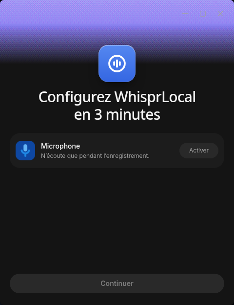

# WhisprLocal

**Your voice, your machine, your models.** An independent Linux desktop edition of [OpenWhispr](https://github.com/OpenWhispr/openwhispr), focused on local and explicitly configured self-hosted inference.

[Français](README.fr.md) · [Downloads](https://github.com/valoche-68/whisprlocal/releases) · [Contributing](.github/CONTRIBUTING.md) · [Upstream tracking](docs/UPSTREAM.md)

> WhisprLocal is an independent derivative. It is **not affiliated with, endorsed by, or operated by OpenWhispr, Gizmo Labs, or OpenAI**. Whisper is a model originally released by OpenAI; using it does not imply any affiliation.



Initial project version: **0.1.0**. Upstream base: **OpenWhispr 1.11.0**. These versions are tracked independently in [`upstream.json`](upstream.json).

## What stays familiar

The official application layout, components, themes and onboarding screens are retained. Account and connected-service steps are omitted. Dictation, keyboard shortcuts, clipboard and automatic paste, notes, meetings, audio-file imports, dictionary, snippets, assistants and local usage statistics work with local models or supported self-hosted endpoints.

Whisper unloads after the complete transcription finishes: **5 seconds by default**, with 5 / 10 / 30 / 60 / 300 second choices and a persistent on/off switch. Settings take effect immediately. The next dictation reloads the model. Official CUDA packs bundle their CUDA 12 runtime libraries; no Python environment is required.

## What is different

| Included                                            | Removed                                                          |
| --------------------------------------------------- | ---------------------------------------------------------------- |
| Local speech and language models                    | Accounts, login and official synchronization                     |
| Self-hosted servers and optional server credentials | AI cloud providers and provider API keys                         |
| Authenticated loopback API                          | Subscriptions, billing, plans and team workspaces                |
| Bundled CLI and MCP over stdio                      | Remote MCP and the cloud CLI                                     |
| Model and GPU engine downloads                      | Account-based calendar and third-party connectors                |
| Local usage statistics                              | Telemetry and diagnostic uploads, with no switch to restore them |

Removing an integration does not turn it into a local service. Automatic screenshot context and the independent vision-model override are unavailable in this edition: upstream's local/self-hosted route does not implement their image transport. Text assistants remain available. Self-hosted realtime meeting transcription is not provided by upstream 1.11.0.

## Supported platform

**Linux x86_64 only.** Windows, macOS and Android are not supported or published by this project. Historical cross-platform source remains in the upstream history. GPU acceleration is optional; supported NVIDIA hardware uses the complete official CUDA pack, and CPU inference remains available.

## Install

Download the `.deb`, `.AppImage` or `.tar.gz` and `SHA256SUMS` from this repository's [Releases](https://github.com/valoche-68/whisprlocal/releases). Verify downloaded artifacts before installation:

```sh
sha256sum --check SHA256SUMS --ignore-missing
```

For Debian packages, use your distribution's package installer. For AppImage, make the file executable and launch it. AppImage may require your distribution's FUSE compatibility package.

For an unpacked installation in your user account, extract the archive and run **`resources/install.sh` inside its extracted application folder**. It installs versioned files under `~/.local/opt/WhisprLocal`, creates a menu entry and links `~/.local/bin/whisprlocal`. Ensure `~/.local/bin` is on your `PATH`.

No model is downloaded automatically merely to import an existing profile. The existing compatible OpenWhispr model cache is reused. Model and engine downloads require a network connection; transcription with downloaded local models works offline.

## Keep your existing settings

Close OpenWhispr and WhisprLocal first. From the new extracted application, run:

```sh
./whisprlocal --cli profile migrate "$HOME/.config/open-whispr"
```

This creates a private full backup, then imports selected preferences, shortcuts, the local database and retained audio into **`~/.config/whisprlocal`**. Existing destination profiles are never overwritten. Cookies, account sessions, cloud credentials, synchronization identities and private logs are excluded. Compatible GPU packs are preserved; outdated packs must be replaced with complete official packs. Self-hosted server credentials may need to be entered again when the old application encrypted them using its account-specific storage.

The original profile and installation are preserved. Read the private `migration-report.json` in the new profile for your backup location. Never upload a profile, backup, token, private log or model to this repository.

## CLI, API and MCP

The desktop application must be open. The bundled client uses the application's authenticated local bridge; no npm CLI, online account or cloud key is needed.

```sh
whisprlocal --cli notes list
whisprlocal --cli notes search --q "meeting"
whisprlocal --cli dictionary list
whisprlocal --cli history list
whisprlocal --cli transcribe file /absolute/path/audio.wav --language fr
whisprlocal --cli --help
```

API operations include notes (list/search/read/create/update/delete), folders (list/create), dictionary and snippets (list/update), history (list/read/delete/delete audio) and file transcription with installed models. Run `--help` for flags and JSON input. The bridge binds to **127.0.0.1** and writes its technical token to `~/.whisprlocal/cli-bridge.json` with mode **0600**. The CLI and MCP read it automatically. Do not share this file.

For an MCP client, use the **absolute path to your installed executable**. The Integrations screen provides a configuration to copy:

```json
{
  "mcpServers": {
    "whisprlocal": {
      "command": "/home/your-user/.local/bin/whisprlocal",
      "args": ["--mcp"]
    }
  }
}
```

MCP uses newline-delimited JSON-RPC over stdio. Tool calls modify the same local data as the desktop application; configure your MCP client's approval settings accordingly. Both clients give an explicit error when WhisprLocal is closed.

## Privacy and network behavior

There is no account client, telemetry sender, diagnostic uploader or official synchronization transport in the local edition. Local statistics remain in SQLite. The application blocks OpenWhispr web domains and unconfigured network destinations in Node HTTP/fetch and Electron sessions.

Network access is retained for model and engine downloads from their sources (GitHub and Hugging Face), this project's GitHub release feed, and server origins you explicitly configure. A self-hosted server receives the audio or text you send to it. Local does not mean air-gapped: you can disconnect the network once your models are installed.

See [`docs/PRIVACY.md`](docs/PRIVACY.md) for the implemented boundary and verification scope.

## Updates and rollback

Updates are fetched exclusively from **`valoche-68/whisprlocal`**. WhisprLocal never switches to an unmodified official OpenWhispr build.

- **AppImage:** integrated `electron-updater` support.
- **Managed unpacked installation:** download the archive, verify SHA256, extract to a versioned staging folder and switch the `current` symlink after the application exits. The preceding version remains under `previous`.
- **Debian:** download and verify the package, then request administrator authentication for installation.

The hourly upstream monitor prepares a migration branch and draft pull request. Successful checks make it ready for human review; conflicts produce a blocking file report. **No automatic merge or public release.** The manually launched release workflow builds Linux artifacts and creates a **draft release** for human publication. Build/test jobs do not receive publication credentials.

## Build and contribute

Node.js **24+**, npm, a Linux x86_64 build environment, GCC, GLib development headers and PipeWire development headers are required. Dependencies and helper downloads need internet access during the build.

```sh
npm ci --ignore-scripts
npm rebuild better-sqlite3 --runtime=node
npm run typecheck
node scripts/whisprlocal/checks.cjs
npm run test:local
node node_modules/electron/install.js
node node_modules/ffmpeg-static/install.js
npm run download:embedding-model -- --for-build
npm run build:linux -- --publish never
```

`electron-builder` rebuilds native dependencies for Electron when packaging. No licensed proprietary brand font download or upstream signing identity is used. The existing open-source font fallbacks are bundled locally.

## Credits and license

Derived from [OpenWhispr](https://github.com/OpenWhispr/openwhispr) by the OpenWhispr Team and its contributors. The complete imported history and original [MIT license](LICENSE) are retained. Speech and language models, GPU engines and bundled dependencies have their own licenses. Thanks to the upstream authors and the whisper.cpp, llama.cpp and sherpa-onnx communities.
